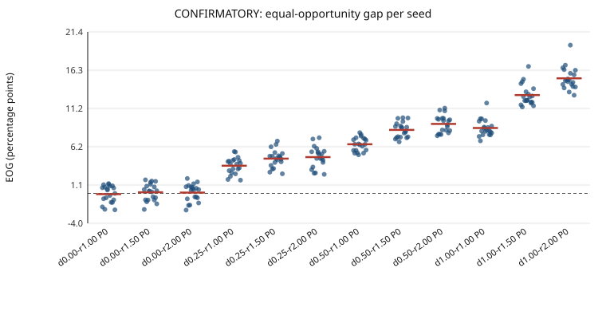

<!-- SPDX-License-Identifier: LicenseRef-RIGGED-NC-Research-1.0 -->
# EXP-001 report: one common threshold under unequal starting distributions

| Field | Value |
|---|---|
| Experiment | EXP-001 |
| Date | 2026-11-25 |
| Version | 1.0 |
| Status | Complete (240 of 240 runs ok). Confirmatory, simulated data. |
| Authorship | Mohamed Bechir Kefi (C3). AI assistant disclosed as a research and development assistant, not an author. |
| Protocol | `research/experiments/EXP-001/protocol.md`, FROZEN v1.0, SHA-256 8a98874cd6a9394d493fab35572a5bff78fbd8cb83e2538111fb9c0bf1933bcf |
| Config | `research/experiments/EXP-001/config.json`, SHA-256 e8be2bc5305426d86c2046060413fc54e975245cff60a5f878effd23d70548cb |
| Code revision | b455d59294ea98e2b050ef30f20bc74b7993969e (tree clean) |
| Results | `results/EXP-001/` (results.json SHA-256 df4a452c70f2fa2c433cabce83c40c3aa247406f15c8ee5f48d90ebee8b520a2) |

## 1. Executive summary

Question: under one common raw-score threshold (P0), are qualified members of a group with a lower starting distribution selected less often, and how does this change with the starting-distribution gap delta and the noise ratio rho? Method: simulated two-group populations (n = 20,000 per population), 12 cells, 20 seeds, common random numbers. Outcome: at delta = 0.5, rho = 1 the equal-opportunity gap (EOG) exceeds the delta = 0 control by 6.59 pp (95% percentile bootstrap [6.20, 6.97]). The interval lies entirely above the +2 pp smallest effect of interest, so H1 is supported. Principal caveat: under the Gaussian model this result follows analytically (population value 6.31 pp). The experiment measures it and checks the implementation; it does not discover a new mechanism. Exploratory values of this contrast were also seen before the freeze (C4).

## 2. Rationale and literature

Error-rate balance generally cannot hold together with other criteria when base rates differ (chouldechova2017, kleinberg2016). Single thresholds are the unconstrained optimum in corbettdavies2017. The equal-opportunity criterion comes from hardt2016. Only abstracts were verified (2026-11-24); full-text reading is still open (roadmap M1). Gap addressed: a quantified, seed-replicated measurement of how large the gap under one shared threshold is, separating the starting distribution (delta) from measurement noise (rho).

## 3. Hypotheses and definitions

- Y = 1[Q > 0]. X = Q + e. Group A: Q ~ N(0, 1). Group B: Q ~ N(-delta, 1). Noise SD sigma_A = 0.5 and sigma_B = rho * 0.5. kappa = 0.30, p_B = 0.5, cost ratio 1.
- EOG = TPR_A - TPR_B, in pp. Positive means qualified members of B are selected less often.
- H0: EOG(delta 0.5, rho 1) - EOG(delta 0, rho 1) = 0. H1 (directional): the difference is at least +2 pp. Contradiction: the 95% bootstrap interval lies entirely below +2 pp.
- H1b (amended before the freeze, A4): EOG at delta = 0 for rho in {1, 1.5, 2}, reported descriptively. It is not directional, and no equivalence is claimed.

## 4. Methodology

- Generator SYN-001: separate fitting and evaluation populations from independent RNG streams of each seed.
- P0 threshold: fitted on the fitting population so that a fraction kappa is selected, with seeded tie-breaking. Metrics are computed on the evaluation population.
- Factorial design: delta in {0, 0.25, 0.5, 1.0} x rho in {1, 1.5, 2}.
- Seeds 0 to 19; 240 runs.
- Statistics: mean paired difference over seeds; percentile bootstrap (10,000 resamples, seed 20261124); t-interval as a check.
- Analytic population values by numerical integration (`rigged.analytic`).
- Environment: Apple M1 Pro (10 cores), macOS 15.3.1, Python 3.12.1, numpy 2.5.4, jsonschema 4.26.0.
- Budget: under 1 minute (A3).

## 5. Implementation verification

- **Before the run:** full suite 116 passed. Exploratory smoke 24/24 ok on seeds 1000 to 1002 (JRN-0008). Metric validation on seeds 1000 to 1019: 28/28 analytic comparisons within 3 bootstrap SE, tables identical to the M2 run (JRN-0009).
- **Confirmatory implementation check** (protocol section 10: simulated means within 3 bootstrap SE of the population values): **48 of 48 comparisons pass**, largest |z| 2.83 (`results/EXP-001/tables/analytic_check.csv`).
- **Primary cells:**
  - d0.50-r1.00: population EOG 6.31 pp, simulated 6.50 pp, z 0.98.
  - d0.00-r1.00: population 0, simulated -0.09 pp, z -0.37.

## 6. Execution record

- **Command:** `scripts/run_confirmatory.sh EXP-001`, which runs `PYTHONPATH=src nice -n 10 .venv/bin/python -m rigged.cli run --experiment EXP-001` through the run guard.
- **Time:** 2026-11-25, 00:15:05Z to 00:15:06Z UTC; wall clock 1.38 s; exit status 0.
- **Resources:** peak RSS 71.7 MiB; mean runtime 0.006 s per run.
- **Run IDs:** RUN-EXP-001-<cell>-P0-s<seed>. Per-run config hashes are in `results/EXP-001/provenance.json` and `run_manifest.json`.
- **Data manifest SHA-256:** 37194645cd251abaab069a90a26908b3032bdd573097633fb9908bfe9540192d.
- **Runs:** 240 planned, 240 ok, 0 failed. No undefined metric.
- **Deviations (DEC-020):** the 240 P0 runs were also computed inside EXP-002 instead of once. The two copies are identical apart from runtime. The runner records per-run durations and matrix start and end times, not per-run timestamps.

## 7. Results

**Primary contrast** (P0; d0.50-r1.00 minus d0.00-r1.00, paired over 20 seeds; `results/EXP-001/tables/contrasts.csv`):

| Metric | Mean (pp) | SD (pp) | 95% bootstrap | 95% t-interval | Standardised |
|---|---|---|---|---|---|
| EOG (primary) | 6.59 | 0.90 | [6.20, 6.97] | [6.17, 7.01] | 7.29 |
| SR gap | 15.47 | 0.34 | [15.32, 15.60] | [15.31, 15.63] | 45.42 |
| PPV gap | 4.82 | 0.91 | [4.45, 5.22] | [4.39, 5.24] | 5.27 |
| FPR gap | 1.61 | 0.44 | [1.41, 1.79] | [1.40, 1.81] | 3.66 |

**P0 EOG per cell** (seed means, pp, 95% bootstrap; `results/EXP-001/tables/summary.csv`):

| delta \ rho | 1 | 1.5 | 2 |
|---|---|---|---|
| 0 | -0.09 [-0.60, 0.38] | 0.15 [-0.34, 0.62] | 0.11 [-0.40, 0.59] |
| 0.25 | 3.66 [3.20, 4.11] | 4.61 [4.13, 5.09] | 4.80 [4.21, 5.39] |
| 0.5 | 6.50 [6.12, 6.89] | 8.41 [7.99, 8.83] | 9.20 [8.71, 9.68] |
| 1.0 | 8.65 [8.22, 9.16] | 13.01 [12.46, 13.65] | 15.22 [14.64, 15.92] |

**Distributions:** the per-seed strip plot is `research/experiments/EXP-001/figures/XFIG-EXP-001-01-eog.svg`, also in `results/EXP-001/figures/`. Per-seed SD of the P0 EOG ranges from 0.91 to 1.48 pp across cells.

## 8. Interpretation

**H1 (primary).** Measured: the mean paired difference is 6.59 pp, and its interval lies entirely above +2 pp, so H1 is supported.

**Model-dependent inference.** Under the Gaussian model, qualified members of B sit nearer the cutoff, so fewer of them pass a shared threshold. The population value of 6.31 pp falls inside the interval. The gap grows with delta at every rho, and with rho at every delta > 0.

**H1b.** At delta = 0 the EOG is -0.09, 0.15 and 0.11 pp for rho = 1, 1.5 and 2. These values agree with the analytic 0.000, 0.177 and 0.081 pp (A4). The intervals include 0. This is not evidence of equivalence; the values are small relative to 2 pp.

**What could undermine this reading.** Whether the gap is a base-rate effect or a distribution-shape effect is examined in EXP-003. EXP-003 finds that shape near the cutoff, not base rate alone, drives the gap. The statement "a lower base rate lowers TPR" must therefore be narrowed.

## 9. Threats to validity

- **Internal:** the implementation check passed 48/48, and the simulated results match the model.
- **Construct:** EOG is one criterion among several; no metric is universal.
- **External:** these are simulated Gaussian populations with two groups and one score. Nothing is claimed about real groups or decisions.
- **Statistical:** the seed is the unit. 20 seeds give interval half-widths of about 0.4 pp, against a 2 pp smallest effect of interest.
- **Pre-registration:** the result was analytically implied, and exploratory values of the primary contrast were seen before the freeze (C4: SIZING 6.30 pp [6.04, 6.56]; corrected in M4 from 6.31, see `research/publication/evidence_audit.md`).

## 10. Conclusion and next experiment

Within the stated model, one common threshold gives qualified members of the lower-starting-distribution group a lower selection chance: 6.59 pp more than the control at delta = 0.5. The next experiments are EXP-002 (alternative rules and incompatible criteria) and EXP-003 (base rate versus shape).

## 11. Reproduction

See `research/experiments/EXP-001/reproduction.md`.
